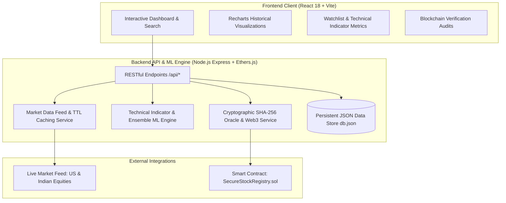

# SecureStock AI: Real-Time Blockchain-Enabled Stock Recommendation System

A full-stack, enterprise-grade financial intelligence platform combining **real-time stock market data feeds (US & Indian NSE/BSE)**, **explainable Machine Learning recommendation models**, **interactive historical charts**, and **cryptographic blockchain verification** via Ethereum smart contracts.

---

## 🏛️ System Architecture



---

## 🚀 Key Features

1. **Real-Time Stock Market Data**:
   - Live/near-real-time quotes for US stocks (NASDAQ/NYSE: `AAPL`, `MSFT`, `NVDA`, `TSLA`, `GOOGL`, etc.) and Indian equities (NSE/BSE: `RELIANCE.NS`, `TCS.NS`, `INFY.NS`, `HDFCBANK.NS`).
   - Live autocomplete ticker search with exchange and country badges.
   - 60-second in-memory TTL caching with rate-limit protection and fallback mechanisms.

2. **Machine Learning Stock Recommendations**:
   - Quantitative feature calculation: 10-day & 20-day SMA, 12-day & 26-day EMA, 14-day RSI, MACD momentum spread, and annualized historical volatility.
   - Calibrated ratings (`BUY`, `HOLD`, `SELL`) with 14-day projection horizons.
   - Clear factor explanations (e.g., oversold RSI, moving-average crossovers).
   - Unambiguous disclaimers distinguishing statistical forecasts from personalized financial advice.

3. **Interactive Visualizations & Watchlist**:
   - Dynamic time horizons (`5D`, `1M`, `3M`, `1Y`) for historical charts.
   - Quick-add / remove user watchlists with real-time ticker quotes.
   - Market volatility comparison and volume tracking.

4. **Blockchain Integrity & Smart Contract Verification**:
   - Minimal on-chain metadata footprint (symbol, recommendation type, target price, model version, timestamp, data hash).
   - Canonical SHA-256 cryptographic hashing to prevent data tampering.
   - Instant cryptographic verification by Recommendation ID or Ethereum Transaction Hash.
   - Solidity smart contract: `backend/contracts/SecureStockRegistry.sol`.

---

## 🔑 Authentication Credentials

* **Default Admin Account**: `admin@securestock.ai`
* **Default Password**: `admin123`
* **1-Click Login**: Available directly on the sign-in screen.

---

## 📦 Prerequisites & Dependencies

* **Node.js**: v18.0.0 or higher (v22+ recommended)
* **npm**: v9.0.0 or higher
* **Git**

---

## 🛠️ Quick Start & Local Setup

### 1. Clone & Install Dependencies

```bash
# Install root orchestrator dependencies
npm install

# Install backend dependencies
cd backend
npm install
cd ..

# Install frontend dependencies
cd securestock-ai
npm install
cd ..
```

### 2. Environment Variables Configuration

Copy the example environment configuration:
```bash
cp backend/.env.example backend/.env
```

| Variable | Description | Default |
|---|---|---|
| `PORT` | Backend server port | `5000` |
| `BLOCKCHAIN_RPC_URL` | Ethereum RPC endpoint | `https://rpc.sepolia.org` |
| `CONTRACT_ADDRESS` | Deployed Registry Smart Contract address | `0x5eC970c4D99b21C42E570FaC77dBcfF34A5Eb619` |
| `EXPLORER_URL` | Block explorer base URL | `https://sepolia.etherscan.io` |

### 3. Run the Full Application

From the root project directory:
```bash
npm run dev
```

* **Frontend Client**: [http://localhost:5173](http://localhost:5173)
* **Backend API**: [http://localhost:5000](http://localhost:5000)
* **Health Check**: [http://localhost:5000/api/health](http://localhost:5000/api/health)

Alternatively, on Windows, double-click `start-project.bat`.

---

## 🧪 Automated Testing

Run the integration and unit test suite:
```bash
node backend/tests/system.test.js
```

Covers:
* Technical indicator calculations (SMA, EMA, RSI, Volatility).
* Machine Learning recommendation generation & bounds.
* Deterministic SHA-256 cryptographic hashing.
* Blockchain record creation & tamper detection.
* Market search and symbol resolution.

---

## 📡 API Endpoint Reference

| Method | Endpoint | Description |
|---|---|---|
| `GET` | `/api/health` | Service health status, oracle state, and contract address |
| `POST` | `/api/auth/login` | Authenticate user & return signed JWT (rate-limited) |
| `POST` | `/api/auth/register` | Register new user with bcrypt hash & password validation |
| `POST` | `/api/auth/logout` | Revoke session / logout |
| `POST` | `/api/auth/forgot-password` | Request password reset token / availability status |
| `GET` | `/api/auth/me` | Fetch authenticated user profile & role (`requireAuth`) |
| `GET` | `/api/stocks/search?q={query}` | Search US & Indian tickers with live autocomplete |
| `GET` | `/api/stocks/{symbol}/quote` | Fetch live quote, bid/ask, day high/low, and volume |
| `GET` | `/api/stocks/{symbol}/history?range=1mo&interval=1d` | Historical candles for charting |
| `GET` | `/api/stocks/{symbol}/indicators` | Technical indicator values (RSI, SMA, MACD, etc.) |
| `GET` | `/api/stocks/{symbol}/recommendation` | Generate or fetch ML recommendation & blockchain record |
| `GET` | `/api/watchlist` | Get authenticated user's stock watchlist (`requireAuth`) |
| `POST` | `/api/watchlist` | Add stock to user's watchlist (`{ symbol: "NVDA" }`, `requireAuth`) |
| `DELETE` | `/api/watchlist/{symbol}` | Remove stock from user's watchlist (`requireAuth`) |
| `GET` | `/api/blockchain/records` | Get all verified on-chain recommendation records |
| `GET` | `/api/blockchain/verify/{recId}` | Verify integrity of recommendation by ID |
| `GET` | `/api/blockchain/verify-tx/{txHash}` | Verify recommendation by Ethereum transaction hash |
| `POST` | `/api/recommendations/verify` | Verify untampered payload against blockchain hash |

---

## 🔒 Security & Authentication Architecture

* **Password Hashing**: All user passwords are encrypted using `bcrypt` (12 salt rounds); plaintext passwords are never persisted.
* **HMAC-SHA256 JWT Authorization**: Private endpoints (`/api/auth/me`, `/api/watchlist`, `/api/user/settings`) require signed JWT Bearer tokens validated by server-side `requireAuth` middleware.
* **Data Isolation**: Watchlists and portfolios are strictly partitioned by authenticated user ID, preventing cross-user data leakage.
* **Brute-Force Protection**: Login attempts are tracked per client IP and email. Exceeding 5 failed attempts triggers a 15-minute lockout (`HTTP 429`).
* **Input Validation & Sanitization**: Strong password length enforcement (minimum 8 characters), email format regex validation, and generic error messages ("Invalid email or password.") to prevent user enumeration attacks.
* **Realistic Password Recovery**: If outbound SMTP/email verification is unconfigured, the system explicitly reports that email recovery is unavailable rather than asserting false delivery.
* **Role-Based Access Control**: Standard public sign-ups are assigned `Standard Investor` ("Read Only" smart contract role) and cannot escalate privileges to Admin.

### Authentication Test Suite

Run the end-to-end authentication and security test:
```bash
node backend/test-auth.js
```
